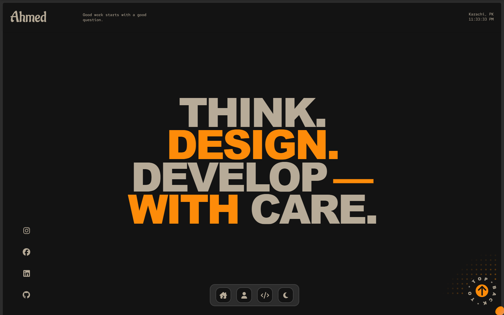

# Ahmed Ashar | Developer Portfolio

A personal portfolio and content dashboard by **Muhammad Ahmed Ashar**, a web developer based in Karachi, Pakistan. Built around bold typography, purposeful motion and a curated selection of frontend and full-stack projects.

[Visit the website](https://ahmed-ashar.vercel.app) · [Dashboard guide](docs/DASHBOARD.md) · [Get in touch](mailto:hafizmahmedashar@gmail.com)

[](https://ahmed-ashar.vercel.app)

## Overview

The public website brings together selected work, professional background and contact information in a responsive interface. A password-protected dashboard manages the site's content, appearance and metadata, with separate draft and publishing workflows.

### Website

- **Project showcase** with Frontend, Backend and MERN Stack filters.
- **Project stories** at `/projects/:slug`, with editable sections, screenshots, technologies and separate live-site/GitHub links.
- **Responsive layouts** for desktop, tablet and mobile, with dark and light themes.
- **Interactive motion** including scroll reveals, animated typography, magnetic buttons and a navigation dock.
- **About and contact pages** covering skills, education, experience and social profiles.
- **Server-rendered content** with page-specific metadata, social previews, structured data and a sitemap.

### Content dashboard

- Edit page sections, navigation, projects, social links, colors and search metadata.
- Add and reorder content, control section visibility and upload project images.
- Write case studies in **Project stories**, including the process, challenges, results and lessons learned.
- Save drafts and preview changes before publishing to the website.
- Export or import content backups and restore the previous publication as a draft.
- Manage content through authenticated server endpoints and persistent storage.
- Explore audience trends, scroll depth, project interactions and page engagement with GA4 charts, period comparisons and CSV exports (requires Analytics property access).

## Technology

| Layer | Tools |
| --- | --- |
| Interface | React 19, React Router 7 |
| Styling | Tailwind CSS 4, custom CSS, self-hosted fonts |
| Animation | GSAP, Framer Motion, Lenis |
| Build | Vite 7, server rendering and static fallback pages |
| Backend | Node.js, Vercel Functions |
| Content storage | Private Vercel Blob in production; local files in development |
| Quality checks | ESLint, Playwright, GitHub Actions |
| Analytics | Google Analytics 4, Vercel Speed Insights |

## Getting started

**Requirements:** Node.js `^20.19.0 || >=22.12.0` and npm.

```sh
git clone https://github.com/ahmed-ashar/Portfolio.git
cd Portfolio
npm ci
npm run dev
```

Open `http://127.0.0.1:5173` to view the website. Visit `/dashboard` to create a local administrator password and start editing.

Local credentials, sessions, content and uploads are stored in the Git-ignored `.local/` directory. Publishing locally changes only the local website.

## Project structure

```text
api/                 Vercel function entry points
public/              Images, fonts, icons and browser scripts
server/              Authentication, storage and page rendering
src/
  components/        Website sections and shared UI
  content/           Default content and validation schema
  context/           Content and theme providers
  pages/             Public pages and content dashboard
  utilis/            Animation utilities and hooks
  seo.js             Page metadata and structured data
scripts/             Build, admin setup and verification tools
tests/               Website and dashboard browser tests
docs/                Dashboard documentation and homepage preview
vercel.json          Production routing, headers and function settings
```

Initial content lives in `src/content/defaults.json`, with project screenshots in `public/images/`. Once the production dashboard is configured, published edits are loaded from shared storage without a rebuild.

## Deployment

Deploy the repository to Vercel using `npm run build`. The build produces client assets in `dist/` and a server renderer in `dist-ssr/`; `vercel.json` configures the functions to serve the published pages.

To enable the production dashboard:

1. Connect a **private Vercel Blob store** to the project.
2. Run `node scripts/admin-password.mjs` in an interactive terminal to generate an administrator password hash.
3. Configure the following server environment variables, then deploy.

| Variable | Purpose |
| --- | --- |
| `BLOB_READ_WRITE_TOKEN` | Access to the project's private Blob store |
| `ADMIN_PASSWORD_HASH` | Password hash generated in `.local/admin-password.hash` |

Keep these values in Vercel's environment settings. They must not be committed or prefixed with `VITE_`.

Without the production configuration, dashboard access remains disabled and the public site uses its default content. Local content and uploaded images do not transfer automatically. See the [dashboard guide](docs/DASHBOARD.md) for publishing, backups and storage setup.

## Development commands

| Command | Purpose |
| --- | --- |
| `npm run dev` | Start the local website and dashboard |
| `npm run build` | Build client assets, server rendering and static fallback pages |
| `npm run lint` | Check the source with ESLint |
| `npm test` | Run public website browser tests against the existing build |
| `npx playwright test --config playwright.dashboard.config.js` | Run isolated dashboard tests against the existing build |
| `npm run check` | Run lint, build and public website tests |
| `npm run test:visual -- current` | Capture local visual review screenshots |

Browser tests use installed Google Chrome by default. To use bundled Chromium, run `npx playwright install chromium` and set `PLAYWRIGHT_CHANNEL=chromium` in your shell.

The test suites cover responsive layouts, themes, navigation, project filters, page metadata, dashboard authentication, editing, publishing and scrolling. GitHub Actions runs lint, build, public website tests and a dependency audit on pushes and pull requests. Temporary reports, visual review captures and build output are excluded from Git.

## Author

**Muhammad Ahmed Ashar**

Web Developer · Karachi, Pakistan

[Website](https://ahmed-ashar.vercel.app) · [GitHub](https://github.com/ahmed-ashar) · [LinkedIn](https://www.linkedin.com/in/ahmed-ashar/) · [Email](mailto:hafizmahmedashar@gmail.com)
